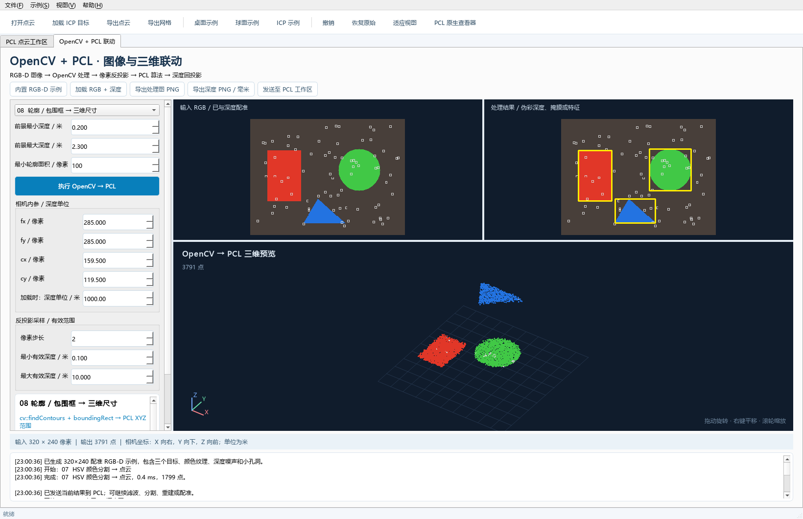
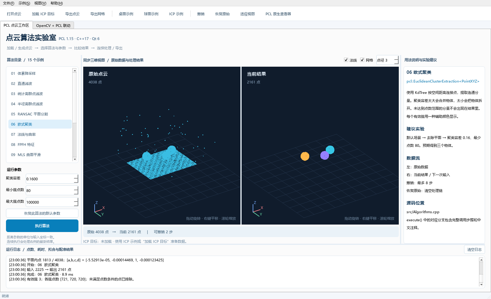

# OpenCV + PCL Demo · 图像与点云算法实验室

这是一个可用于学习的 **C++17 / OpenCV / PCL / Qt Widgets 桌面项目**。使用 PCL 1.15.1 与 OpenCV 5.0.0。支持 15 个 PCL 示例和 10 个 OpenCV 与 PCL 联动示例；内置点云和 RGB-D 数据。

## OpenCV + PCL 联动

启动后切换到 **“OpenCV + PCL 联动”页签**。左侧选择算法与参数，上方对比输入 RGB 和处理图，下方预览对应的三维点云。

| 新增示例 | 作用 |
| --- | --- |
| RGB-D 反投影 | 用内参和深度生成带像素辅助色的三维点云 |
| 深度中值滤波 | 去除深度噪声后重新生成点云 |
| 双边保边滤波 | 平滑深度，尽量保留深度跳变 |
| 深度阈值分割 | 二维深度掩膜选择三维前景 |
| 形态学开闭运算 | 清理前景掩膜，再提取点云 |
| Canny 边缘 | 将颜色边缘关联到三维空间 |
| HSV 颜色分割 | 提取对应物体点云，支持跨零色相区间 |
| 轮廓与包围框 | 检测前景目标，报告相机轴向 XYZ 范围 |
| ORB 特征 | 检测二维关键点、计算描述子、关联三维深度 |
| PCL 点云回投影 | 当前点云经 Z-buffer 投影为深度图 |

推荐：**HSV 颜色分割 → 执行 → 发送至 PCL 工作区 → 体素降采样 → 返回联动页 → PCL 点云回投影**。也可直接执行“轮廓 / 包围框”，观察三个目标的二维框和 XYZ 轴向尺寸。

输入约定、参数解释和练习路线见 [OpenCV 与 PCL 联动说明](docs/OpenCV-PCL.md)。



## 启动

双击项目根目录的 **`Run-Demo.cmd`**。

已生成的 VS 程序位于 `bin/Release/PCLDemo.exe`。建议通过启动脚本运行：脚本会为当前进程补齐 PCL、VTK、OpenNI2、Qt 的 DLL 路径，**不会修改系统环境变量**。如果程序尚未构建，脚本会先编译。

## 在 Visual Studio 中打开

直接双击项目根目录的 **`PCLDemo.sln`**。

1. 选择 `Debug | x64` 或 `Release | x64`。
2. 如有需要，将 `PCLDemo` 设为启动项目（此解决方案只有一个项目）。
3. 按 `Ctrl+Shift+B` 编译，按 `F5` 调试运行。

这是可直接维护的原生 C++ 项目 `PCLDemo.vcxproj`，不需要预先运行 CMake，也不需要安装 Qt VS Tools。Qt `moc` 通过项目中的自定义生成规则自动执行。

项目已配置 C++17、UTF-8、AVX2，并保留当前选择的 v145 工具集；Debug / Release 对应运行库、OpenCV / PCL 库文件、F5 DLL 路径与 Qt 插件路径均已设置。原有源码位于“Source Files / Header Files”，新增联动源码位于“OpenCV PCL Sources / Headers”，生成代码位于“Generated Files”。

输出目录：`bin/Debug`、`bin/Release`；中间文件和 Qt 自动生成代码按工具集、平台、配置隔离，例如 `obj/v145/x64/Debug`。切换工具集不会复用另一工具集的中间文件。

Qt 自动生成由 `GenerateQtMetaObjects` 目标统一顺序执行，生成完成后再编译。头文件没有改变时不会重复生成。若 VS 提示项目文件已在外部修改，请重新加载项目后再生成。

依赖配置集中在 `config/QtAndProject.props`、`config/OpenCV.props` 和两份 `config/PCL1.15.1_*.props`。迁移机器时修改这些属性表以及 `scripts/Environment.ps1` 中的路径即可。PCL 属性表已复制到项目中，不依赖 `D:\PCL` 根目录下的那两份属性表文件。

界面操作：

1. 在工具栏选择“桌面示例”“球面示例”“ICP 示例”，或打开自己的 PCD / PLY。
2. 左侧选择算法，右侧查看原理、API 和建议参数。
3. 调整左下参数，点击“执行算法”。
4. 结果显示在右侧，并成为下一次运算的输入；左侧始终显示原始点云。
5. 可以连续处理、撤销最近 8 步、恢复原始数据，最后导出点云或网格。



## 示例目录

| 示例 | 主要 PCL API | 学习重点 |
| --- | --- | --- |
| 体素降采样 | `VoxelGrid::setLeafSize / filter` | 用体素质心减少点数 |
| Z 轴直通滤波 | `PassThrough::setFilterLimits` | 裁剪空间范围 |
| 统计离群点滤波 | `StatisticalOutlierRemoval` | K 近邻距离统计 |
| 半径离群点滤波 | `RadiusOutlierRemoval` | 按邻域密度剔除孤立点 |
| RANSAC 平面分割 | `SACSegmentation`、`ExtractIndices` | 平面模型、内点、补集 |
| 欧式聚类 | `EuclideanClusterExtraction` | KdTree、连通分量、点数阈值 |
| 法线与曲率 | `NormalEstimation` | 局部协方差、法线朝向 |
| FPFH 特征 | `FPFHEstimation` | 法线输入、33 维局部描述子 |
| MLS 曲面平滑 | `MovingLeastSquares` | 局部多项式拟合、输出法线 |
| 贪婪三角化 | `GreedyProjectionTriangulation` | PointNormal、曲面邻域、网格拓扑 |
| KdTree K 近邻 | `KdTreeFLANN::nearestKSearch` | 查询索引、平方距离 |
| KdTree 半径搜索 | `KdTreeFLANN::radiusSearch` | 按空间半径搜索邻居 |
| 八叉树占据体素 | `OctreePointCloudSearch` | 空间索引、体素中心、体素搜索 |
| 刚体坐标变换 | `transformPointCloud`、`Eigen::Matrix4f` | 齐次坐标、旋转和平移 |
| ICP 精配准 | `IterativeClosestPoint` | 源与目标、收敛、fitness、变换矩阵 |

另外演示 `loadPCDFile`、`loadPLYFile`、`savePCDFileBinary`、`savePLYFileBinary`、`removeNaNFromPointCloud`、`concatenateFields`、`PCLVisualizer` 等常用接口。

## 推荐实验

### 一、去掉桌面，分离三个物体

1. 点击“桌面示例”：包含有噪声的平面、三个球状目标和随机离群点。
2. 选择“RANSAC 平面分割”：距离阈值 `0.025`，最大迭代 `300`，保留平面 `0`。
3. 执行后切换“欧式聚类”：容差 `0.16`，最少点数 `80`，最多点数 `100000`。
4. 执行，右侧三个物体以不同辅助颜色显示，日志列出簇数与各簇点数。
5. 可先“统计离群点滤波”，再分割、聚类，比较结果。

注意：平面还在时，物体可能通过背景连接，聚类结果与去除平面后的结果不同。

### 二、观察法线、平滑与网格重建

1. 点击“球面示例”：用固定种子生成轻微径向噪声的均匀球面采样。
2. “法线与曲率”：K=`20`，显示长度 `0.12`。黄色短线是法线，冷暖色表示曲率。
3. “MLS 曲面平滑”：搜索半径 `0.18`，多项式阶数 `2`。
4. “贪婪三角化”：搜索半径 `0.22`，mu=`2.5`，法线 K=`20`。
5. 点击“导出网格”，保存带三角形拓扑的 PLY。

网格在嵌入视图里以线框显示。GP3 不保证水密，不能替代完整的扫描重建流程。

### 三、学习 ICP 对齐

1. 点击“ICP 示例”：程序生成非对称曲面，并创建一个已知的小角度、小平移源点云。
2. 自动选择 ICP；直接使用默认参数执行。
3. 蓝色是源 / 配准结果，绿色是目标；两者重合表明拟合良好。
4. 查看日志中的 `hasConverged`、fitness 和 4×4 变换矩阵。
5. 也可以先打开源文件，再点击“加载 ICP 目标”选择另一个文件。

ICP 是局部精配准方法，初始偏差太大、缺少重叠、几何退化都可能失败。`hasConverged=true` 不保证得到正确姿态。此处 fitness 使用最大对应距离内的均方距离，单位是输入坐标单位的平方。

### 四、搜索与坐标变换

使用 K 近邻或半径搜索，改变查询点索引；红色为查询点，黄色为命中的邻居。PCL 返回的距离数组是**平方距离**。

坐标变换中依次设置 XYZ 平移和绕 Z 的角度。程序先旋转再平移，输出满足 `p_out = T * p_in`。两侧视图共享包围盒与相机，不会分别重新居中掩盖实际位移。变换后超出视野时按 `F`。

## 三维查看操作

| 操作 | 效果 |
| --- | --- |
| 鼠标左键拖动 | 旋转 |
| 右键或中键拖动 | 平移 |
| 滚轮 | 缩放 |
| 双击 | 恢复默认观察角度、缩放与平移 |
| `F` / “适应视图” | 以原始、结果与目标的共同包围盒重新取景 |
| 顶部法线 / 网格勾选框 | 切换辅助图形 |
| “点径” | 改变点的绘制大小 |
| “PCL 原生查看器” | 用独立进程打开真正的 PCLVisualizer / VTK 窗口 |

嵌入视图为 Qt 的正交投影绘制，不依赖此 PCL 安装包中未提供的 QVTK Qt 集成插件。它会按深度绘制点、同步相机、显示法线和网格线框。算法运算全部由 PCL 完成。

原生查看器展示当前 XYZ 点云，不显示嵌入视图的聚类辅助色、法线或网格。每次打开时会在可执行文件旁的 `output` 目录保存一个预览 PCD；可在关闭查看器后自行删除这些预览文件。

## 编译环境

本机已经配置：

| 组件 | 路径 / 配置 |
| --- | --- |
| PCL | `D:\PCL`，1.15.1，x64 |
| OpenCV | `D:\opencv\5.0.0\opencv`，5.0.0，`opencv_world500[d]`，x64 |
| Qt | `D:\software\Qt\6.12.0\msvc2022_64` |
| Visual Studio | 18 / 2026；原生 VS 项目保留当前 **v145**，可选 CMake 预设为 v143 |
| CMake | `D:\Program Files\CMake\bin\cmake.exe`，4.2.8 |
| C++ 标准 | C++17 |
| 指令集 | AVX2，与已安装 PCL 的 `PCLConfig.cmake` 一致 |
| 运行库 | Debug `/MDd`，Release `/MD` |

**不要选择 MinGW 版 Qt。** 本机 PCL 是 MSVC 库。

双击 `Build-Release.cmd` 或 `Build-Debug.cmd` 可编译对应配置。

也可在 PowerShell 中执行：

```powershell
cd D:\WorkSpace\Codex\PCLDemo
.\scripts\Build.ps1 -Configuration Release
.\scripts\Run.ps1 -Configuration Release
# Debug：
.\scripts\Build.ps1 -Configuration Debug
.\scripts\Run.ps1 -Configuration Debug
```

若 PowerShell 执行策略限制脚本，使用提供的 `.cmd` 入口即可；它仅为本次脚本执行指定策略，不修改系统策略。

默认编译脚本现在直接使用 MSBuild 构建根目录的 `PCLDemo.sln`。如需更换 Visual Studio 安装目录，可修改 `scripts/Environment.ps1` 中的 `$msbuildExe`。

原来的 CMake 构建方式仍然保留为可选入口：`cmake --preset msvc-x64`，再执行 `cmake --build --preset release` 或 `debug`。CMake 输出在 `build`，与原生 VS 项目的 `bin / obj` 相互独立。

仅在使用可选的 CMake 入口并迁移安装目录时，另外修改：

- `CMakePresets.json` 中的 PCL、Qt 路径与 Visual Studio 生成器。
- `CMakeLists.txt` 中的默认 Qt 路径、调试环境与测试环境路径。
- `scripts/Environment.ps1` 中的 CMake、Qt、PCL、OpenNI2 路径。

如果另一台机器使用 Visual Studio 2022，可将生成器改为 `Visual Studio 17 2022`，工具集仍选择 `v143`。

## 源码结构与注释

代码采用较宽松的排版：4 空格缩进，namespace 内的内容逐级缩进，大括号独占一行，一行一条语句，成员变量分别声明，长调用和条件分支展开显示。`.clang-format`、`.editorconfig` 与 `AGENTS.md` 保存了这一风格，后续修改请沿用。

```text
PCLDemo/
├─ PCLDemo.sln              Visual Studio 解决方案，直接双击打开
├─ PCLDemo.vcxproj          原生 MSBuild C++ 项目
├─ PCLDemo.vcxproj.filters  VS 解决方案资源管理器的文件分组
├─ config/                 Qt、PCL 与 OpenCV 的本地属性表
├─ CMakeLists.txt             构建、依赖、运行库、AVX2 与 CTest
├─ CMakePresets.json          本机 MSVC x64 构建预设
├─ Run-Demo.cmd              双击启动
├─ Build-Release.cmd         双击编译 Release
├─ Build-Debug.cmd           双击编译 Debug
├─ scripts/
│  ├─ Environment.ps1        当前进程的依赖搜索路径
│  ├─ Build.ps1              MSBuild 编译 VS 解决方案
│  ├─ Run.ps1                启动桌面应用
│  └─ Test.ps1               运行算法与界面验证
├─ src/
│  ├─ main.cpp               Qt 入口 / PCL 原生查看器入口
│  ├─ Algorithms.h/.cpp      点云类型、参数说明、示例生成、I/O、15 个算法
│  ├─ PointCloudView.h/.cpp  正交投影、点绘制、法线 / 网格、相机交互
│  ├─ MainWindow.h/.cpp      操作界面、数据流、后台任务、撤销、导出
│  ├─ SelfTest.h/.cpp        PCL 算法数值、I/O、UI 流程与截图验证
│  ├─ RgbdAlgorithms.h/.cpp  OpenCV 算法、RGB-D I/O、反投影与 Z-buffer
│  ├─ RgbdPanel.h/.cpp       联动界面、相机参数、后台处理
│  └─ CvSelfTest.cpp         OpenCV 几何、图像 I/O 和双向 UI 验证
└─ artifacts/               实测报告与界面截图
```

建议先阅读 `Algorithms.h` 了解数据结构，再从 `Algorithms.cpp` 的 `execute()` 阅读需要的算法分支。每个分支都展示“创建算法 → 设置输入 → 设置参数 → 执行 → 读取结果”的完整过程。

算法层只读取输入点云并生成新的结果；后台线程不访问 Qt 控件。`MainWindow::runTask()` 负责将结果和异常送回主线程。`history_` 保存最近 8 个结果快照，用于撤销；无效参数或失败任务不会替换已有数据。

## 数据约定与适用范围

- 输入支持具有 XYZ 字段的 PCD / PLY，自动移除无效坐标。
- 本项目统一使用 `pcl::PointXYZ`。额外的 RGB、强度、时间戳字段会忽略；输出点云仅包含 XYZ。
- 聚类颜色、曲率颜色与 FPFH 颜色是界面辅助信息，不会导出。法线和描述子本例只演示计算，不提供独立文件导出。
- 导出点云是二进制 PCD / PLY；“导出网格”保存含三角面拓扑的 PLY。
- 所有距离参数遵循输入单位。内置示例可按米理解；若文件使用毫米，需要同比调整距离阈值。
- 本教学应用接收最多 500,000 点；MLS、FPFH、三角化限制在 100,000 点以内，较大数据先降采样。
- 嵌入视图静止时每个点云最多抽样显示 45,000 点，法线最多 450 条，网格线框最多抽样 12,000 面。旋转、平移、缩放期间每组点云最多显示 12,000 点、网格最多 2,000 面，停止操作约 140 毫秒后恢复静止精度。点云采用像素深度缓冲，显示数据与静止画面均有缓存；处理与导出仍使用完整数据。
- 点云文件会先由 PCL 解析，再检查点数限制；这不是面向任意超大文件的流式浏览器。
- 为兼容中文文件名，Qt 将文件暂存后交给 PCL，再原子提交导出结果。运行目录需要可写；建议保持项目安装路径可用本机代码页表示。
- 后台 PCL 算法没有安全中断机制；运行中禁用数据修改，关闭窗口会提示等待，不强行终止运算。
- 应用使用本机已安装的库，不是可以拷贝单个 EXE 分发的独立安装包。

## 验证

```powershell
.\scripts\Test.ps1 -Configuration Release
.\scripts\Test.ps1 -Configuration Debug
```

验证会在 Qt 离屏模式中运行，不弹出操作窗口，检查全部算法、已知变换的 ICP 恢复、法线归一化、MLS 噪声改善、网格索引、中文路径 PCD / PLY 往返读写，以及界面选择、参数输入、按钮执行、连续处理、撤销、空结果恢复、失败保留数据。

报告在 `artifacts/self-test-Release.txt` 与 `artifacts/self-test-Debug.txt`，截图在 `docs/images/PCLDemo-preview.png`。也可使用 `ctest --test-dir build -C Release --output-on-failure`。

界面截图验证涵盖嵌入式查看器；独立 PCL 原生查看器不在自动 GUI 测试范围内。
